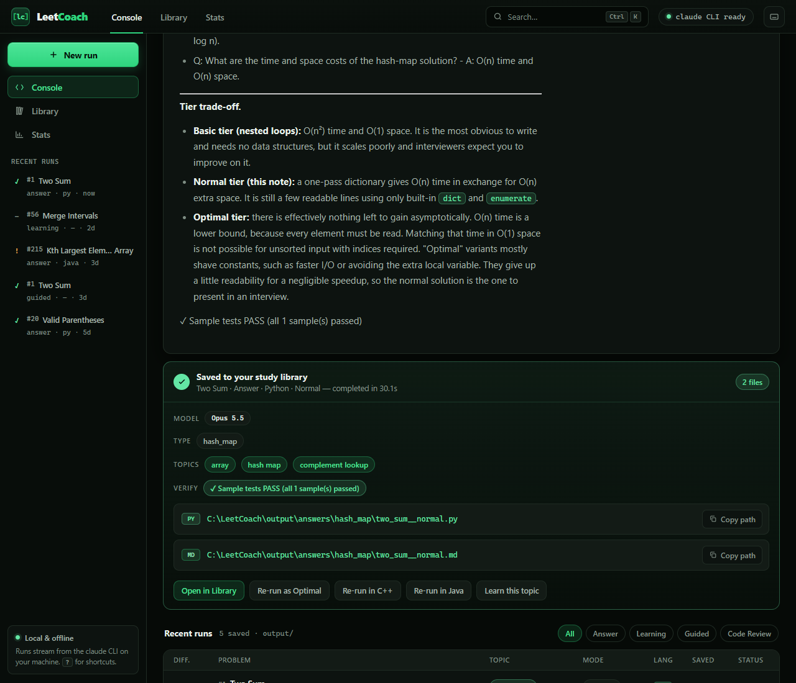
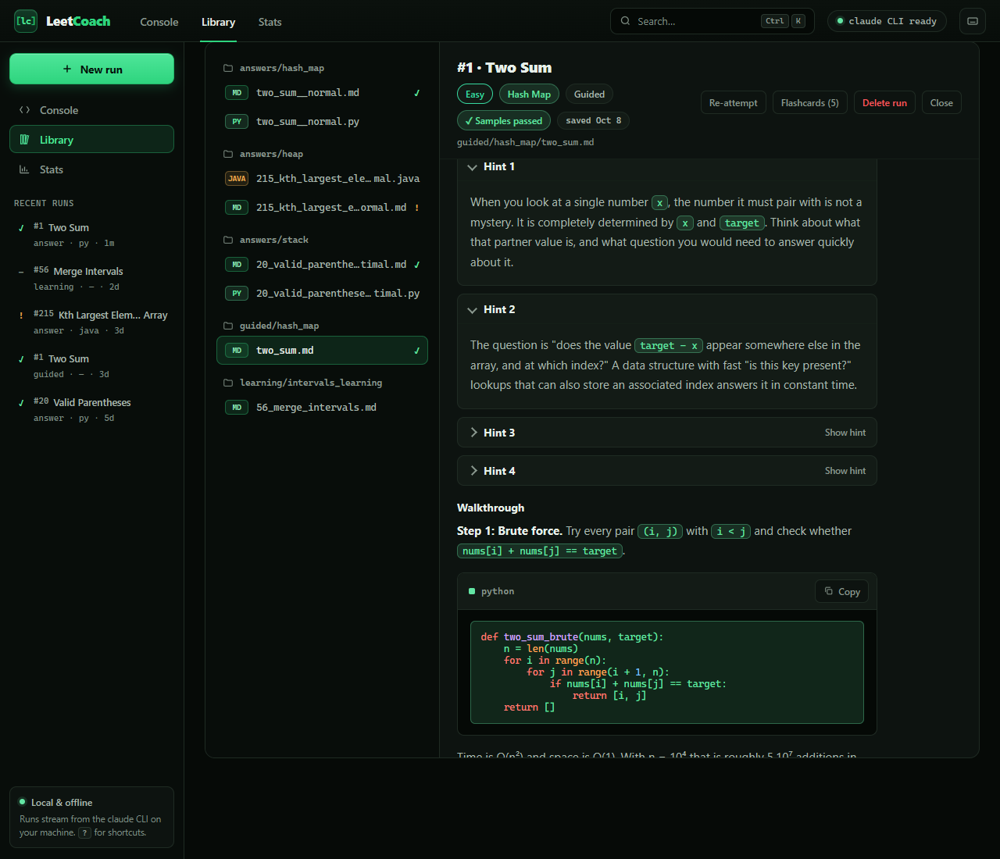
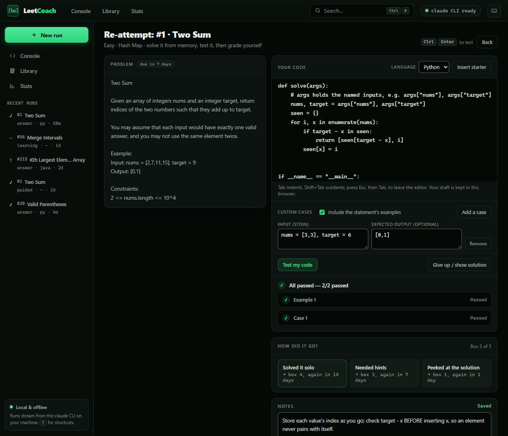
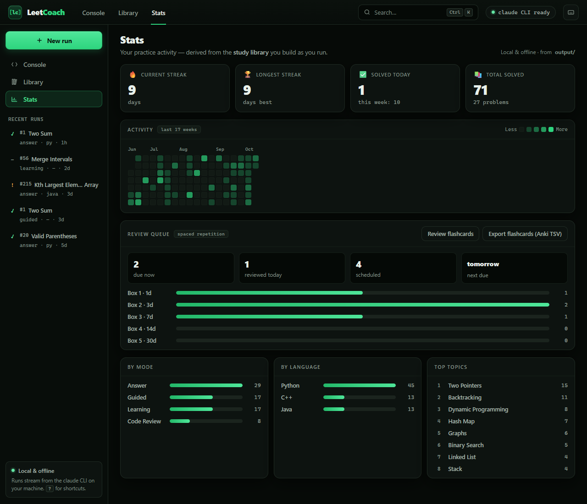
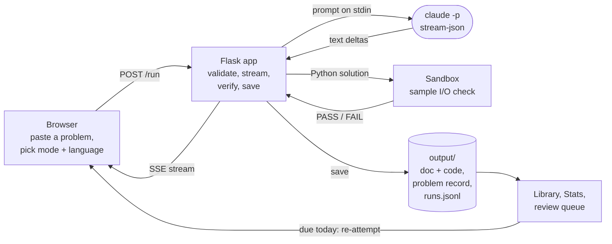
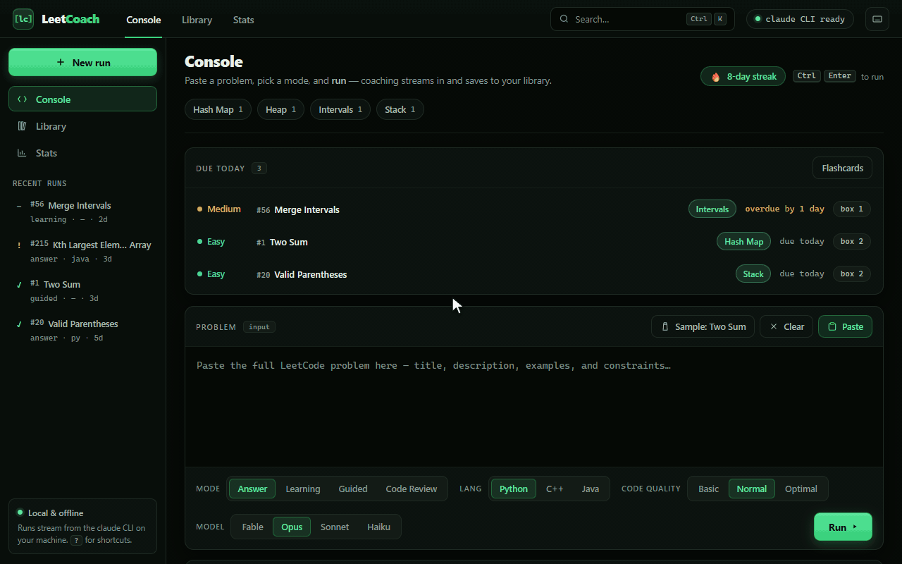

# LeetCoach

[](https://github.com/yib7/LeetCoach/actions/workflows/ci.yml)
[](LICENSE)
[](https://www.python.org/)

A local Flask app that turns a pasted LeetCode problem into streamed, sandbox-verified
study material, then brings it back for spaced-repetition practice.

- **Drives the `claude` CLI headlessly.** `claude -p` gets the prompt on stdin; its
  `stream-json` output is parsed and relayed to the browser over server-sent events.
  No API key: it uses your Claude Code subscription.
- **Isolates every Claude call.** `--safe-mode`, no tools, no MCP servers, its own system
  prompt, a neutral working folder. API-key variables never reach the CLI.
- **Verifies the code it generates.** Python solutions run against the problem's sample
  I/O in a throwaway, resource-capped sandbox: a Job Object on Windows, rlimits on
  POSIX, an audit hook that refuses network, subprocesses and reads outside the run.
  It fails closed.
- **Builds a study loop on an append-only log.** Each run saves a doc, a problem record
  and a line in `runs.jsonl`. That log drives the library, Stats and a Leitner review
  queue.
- **Tested without the model.** 1,574 pytest tests and 101 node tests, all mocking the
  CLI. CI runs them on Windows, Ubuntu and macOS, Python 3.12 to 3.14.

## Screenshots

<table>
  <tr>
    <td width="50%"></td>
    <td width="50%"></td>
  </tr>
  <tr>
    <td align="center">Console: a run streams in and is verified</td>
    <td align="center">Library: hints, follow-ups and notes</td>
  </tr>
  <tr>
    <td width="50%"></td>
    <td width="50%"></td>
  </tr>
  <tr>
    <td align="center">Re-attempt: Test my code, then grade yourself</td>
    <td align="center">Stats and the review queue</td>
  </tr>
</table>

## How it works



1. `POST /run` checks the request, then streams the answer from `claude -p`.
   A second, cheap call classifies the problem into one of 18 patterns.
2. For Answer and Guided runs in Python, the solution runs in the sandbox against the
   problem's `Input:` / `Output:` examples.
3. The doc, the code, the problem record and one `runs.jsonl` line are saved under
   `output/`.
4. The library, Stats and the review queue all read from there.

The full tour is in [docs/ARCHITECTURE.md](docs/ARCHITECTURE.md).

## What it does

- **Four modes.** Learning, Guided Learning, Answer and Code Review (see [Modes](#modes)).
- **One doc structure.** Every doc has the same outline: pattern, key insight, approach,
  solution, complexity, edge cases, common mistakes, related problems, flashcards.
- **Live streaming.** Markdown and syntax highlighting render as the answer arrives.
  Stop cancels a run, and nothing is saved.
- **Practice.** Re-attempt a problem with the answer hidden, run **Test my code**, then
  grade yourself. The review queue brings it back after 1, 3, 7, 14 or 30 days.
- **Follow-ups.** Ask a question on a saved doc. The answer streams in and is appended.
- **Notes and flashcards** per problem, with an Anki export.
- **Stats.** Streak, activity heatmap, review counts, totals by mode, language and topic.
- **Quick Ask.** A side box for small syntax questions, answered by a cheap model and
  never saved.
- **Search.** `Ctrl`/`Cmd`+`K` jumps to any saved problem; `?` lists the shortcuts.

## Setup

You need:

- **Windows 11**, where LeetCoach is developed and tested. Linux and macOS are not tested
  by hand; CI runs the test suite and the Linux / macOS steps below on Ubuntu and macOS on
  every push.
- **Python 3.12 or newer** (CI covers 3.12 to 3.14). On Windows, install it from
  [python.org](https://www.python.org/downloads/); that installer includes the `py`
  launcher setup uses. On Linux and macOS, `python3 --version` must say 3.12 or newer
  (Debian and Ubuntu also need the `python3-venv` package).
- **Git**, to clone the repo.
- **The `claude` CLI** (Claude Code), installed, on your PATH, and signed in. LeetCoach
  drives your Claude Code subscription through it, so there is no API key to set up.

Nothing else: no Node, no database, no build step.

### Windows

**Step 1: get the code.**

```powershell
git clone https://github.com/yib7/LeetCoach.git
cd LeetCoach
```

**Step 2: start LeetCoach.**

```powershell
.\LeetCoach.cmd
```

The first start sets up a `.venv` and installs the pinned dependencies from
`requirements/lock.txt`, which takes about a minute. Every start then checks that `claude`
is signed in (if not, it opens `claude auth login` in its own window) and opens LeetCoach
in your browser at `http://127.0.0.1:5000`, or the next free port if 5000 is busy. Press
`Ctrl+C` or close the window to stop the app, and run the same command to start it again.

**Step 3 (optional): add a desktop shortcut.** Skip it if you start LeetCoach from a
terminal.

```powershell
powershell -ExecutionPolicy Bypass -File .\scripts\create-shortcut.ps1
```

From then on, double-click **LeetCoach** on your Desktop. `-ExecutionPolicy Bypass`
applies to this one command and changes nothing system-wide.

### Linux and macOS

**Step 1: get the code.**

```sh
git clone https://github.com/yib7/LeetCoach.git
cd LeetCoach
```

**Step 2: create a virtual environment.**

```sh
python3 -m venv .venv
```

**Step 3: install the pinned dependencies.**

```sh
.venv/bin/python -m pip install -r requirements/base.txt -c requirements/lock.txt
```

**Step 4: start LeetCoach.**

```sh
.venv/bin/python app.py
```

It opens your browser at the printed URL (`http://127.0.0.1:5000`, or the next free port
if 5000 is busy). Press `Ctrl+C` to stop it, and run the same command to start it again.

### First run

The Console opens ready to go. Paste a problem, or click **Sample: Two Sum**, pick a
mode, language and Code Quality level (and, if you like, a model), and click **Run**. The
answer streams in live and is saved under `output/`. If `claude` is missing or signed
out, the page still loads and a banner tells you what to run.

Every setting is optional; see [Configuration](#configuration) to change the model or
paths.

## Demo



## The `claude` CLI

LeetCoach shells out to `claude -p`, so it needs the CLI installed, on your PATH (or set
`LEETCOACH_CLAUDE_BIN`) and signed in. There is no API key and no secret to configure.

- **Missing or signed out:** the page still loads and a banner says what to run, for
  example `claude auth login`.
- **Desktop launcher:** `LeetCoach.cmd` checks `claude auth status` first and, if you are
  signed out, opens `claude auth login` in its own window. It never blocks the app.
- **Failed run:** the error shows the CLI's own reason (expired login, usage limit,
  unknown model).

Every call is isolated: `--safe-mode`, `--tools ""`, `--strict-mcp-config`, its own
system prompt, and a neutral working folder (`LEETCOACH_CLAUDE_CWD`), so your plugins,
hooks, `CLAUDE.md` and output style never shape a study doc. See
[SECURITY.md](docs/SECURITY.md).

## Modes

| Mode | What you get | Code Quality level |
| --- | --- | --- |
| **Learning** | Teaches the data structures, algorithms and stdlib the problem needs, with a hint ladder. Never a full solution. Skips topics you have already covered. | none |
| **Guided Learning** | One document: restate, teach, reason step by step, then the answer. Hint ladder included. | Basic / Normal / Optimal |
| **Answer** | A working solution, the reasoning, an explicit Big-O line and the trade-offs. | Basic / Normal / Optimal |
| **Code Review** | Paste your own attempt; it critiques bugs, complexity and edge cases without rewriting it. | none |

Code Quality: *Basic* is the simplest approach, *Normal* a balanced interview answer,
*Optimal* the best time and space. Hints (`### Hint 1..4`) are click-to-reveal.

### Verification

- **Python:** the solution reads each sample's input on stdin; its output is compared
  structurally with the expected output (`[0, 1]` equals `[0,1]`). The result is PASS or
  FAIL, and a FAIL saves each failing sample's input, expected and actual output.
- **C++ / Java:** generated, not run. LeetCoach only checks for `g++` / `javac` and
  reports "not auto-verified".
- **No parseable samples:** also "not auto-verified", never a failure.

## Tech stack

| Area | Choice |
| --- | --- |
| Language | Python 3.12+ (CI: 3.12, 3.13, 3.14) |
| Web | Flask, server-sent events |
| Model | `claude` CLI (`claude -p --output-format stream-json`), no API key |
| Sandbox | `subprocess` + Windows Job Objects (ctypes) / POSIX rlimits, `sys.addaudithook` |
| Storage | Plain files under `output/`: Markdown docs, JSON problem records, a JSONL run log |
| Front end | Vanilla JS, vendored `marked` + `highlight.js`, strict CSP, no build step |
| Tests / lint | pytest (1,574 tests), zero-dependency node tests (101), ruff; GitHub Actions on Windows, Ubuntu, macOS |

## Configuration

Settings are environment variables. You can override them in your shell or in a `.env`
file, and all of them are optional. `.env.example` lists the user settings, ready to copy
to `.env`. The three path settings ship commented out there; the table below explains
why. Every timeout is clamped to (0, 86400] seconds, and an invalid value falls back to
the default.

| Variable               | Default                        | What it does                                                        |
| ---------------------- | ------------------------------ | ------------------------------------------------------------------- |
| `LEETCOACH_MODEL`      | `opus`                         | Model passed to `claude --model` for study runs and follow-ups. Use an alias (see below) or pin a full model id. The Console model picker writes this for you, and you can also pick a model per run. |
| `LEETCOACH_CLASSIFIER_MODEL` | `haiku`                  | Model for the short classification call that tags each run with a pattern and topics. |
| `LEETCOACH_QUICK_ASK_MODEL`  | `haiku`                  | Model for the Quick Ask box. The page's Quick Ask tag shows this value. |
| `LEETCOACH_CLAUDE_BIN` | `claude`                       | Name or absolute path of the `claude` executable. The launcher's sign-in check honours it too. |
| `LEETCOACH_OUTPUT_DIR` | `output` next to the app       | Where the study library is written. By default it is relative to the app's own folder. If you set a relative value here, it resolves against your current working directory instead, which is why it's commented out in `.env.example`. |
| `LEETCOACH_TOPIC_INDEX`| `<output_dir>/topic_index.json`| Path to the persisted topic index JSON. The same relative-path caveat applies. |
| `LEETCOACH_CLAUDE_CWD` | `%LOCALAPPDATA%\LeetCoach\claude-cwd` (Windows), `~/.local/share/leetcoach/claude-cwd` (elsewhere) | Neutral folder every `claude` call runs in. The CLI never loads this repo's `CLAUDE.md` or settings, and LeetCoach's saved sessions, which follow-ups resume, stay out of your own projects' Claude Code history. Created on demand. |
| `LEETCOACH_RUN_TIMEOUT`| `600`                          | Wall-clock cap, in seconds, for a single `claude` run. |
| `LEETCOACH_VERIFY_TIMEOUT`| `10`                        | Wall-clock cap, in seconds, for each sandboxed sample check (Answer/Guided verification and Test my code). |
| `LEETCOACH_NO_BROWSER`   | *(unset)*                      | Set to `1`/`true`/`yes` to stop `python app.py` opening your browser on launch. |
| `LEETCOACH_NO_DOTENV`    | *(unset)*                      | Set to `1`/`true`/`yes` to skip loading `.env` entirely and use real environment variables only. |
| `LEETCOACH_DOTENV_PATH`  | `.env` in the repo root        | **Dev/test only.** Where the model picker writes its choice. The test suite and `scripts/dev/run_fake.py` point it at a scratch file. Startup always loads the repo-root `.env`, not this path. |

Not app settings, and not read from `.env`: `scripts/ensure-claude-auth.ps1` reads
`LEETCOACH_AUTH_STATUS_TIMEOUT_MS` (default 15000) and `LEETCOACH_AUTH_LOGIN_TIMEOUT_MS`
(default 300000) from the shell; `scripts/setup.ps1` reads `LEETCOACH_SETUP_PYTHON_EXE`,
a **test-only** override for the Python it bootstraps with; the fake CLI in
`scripts/dev/` reads its own `FAKE_*` variables.

**Model aliases.** The picker offers `fable`, `opus`, `sonnet` and `haiku`. The alias
itself is what reaches `claude --model`, so it always tracks the CLI's newest model of
that family. The picker tooltips and the model chip show the concrete version from
`config.LATEST_MODEL_IDS`, a display-only table:

| Alias    | Shown as in 1.5.0 |
| -------- | ----------------- |
| `fable`  | `claude-fable-5-1` (Fable 5.1, the most capable) |
| `opus`   | `claude-opus-5-5` (Opus 5.5, the default) |
| `sonnet` | `claude-sonnet-5-5` (Sonnet 5.5) |
| `haiku`  | `claude-haiku-5-5` (Haiku 5.5) |

If you pin a full id in `.env` (for example `LEETCOACH_MODEL=claude-sonnet-4-5`), it is
kept when you pick the matching alias for a run.

## Where outputs are saved

Everything lands under `output/` next to the app (gitignored, regardless of the
directory you launch from), organized by problem type:

```
output/
  learning/<pattern>_learning/<problem>.md
  guided/<pattern>/<problem>.md
  answers/<pattern>/<problem>__<level>.<ext>   (code; <level> = basic|normal|optimal)
  answers/<pattern>/<problem>__<level>.md      (reasoning + verification)
  reviews/<pattern>/<problem>__review.md       (Code Review)
  _unsorted/<hash>.md                          (only if a normal save failed)
  topic_index.json
  .leetcoach/                                  (app metadata, hidden from the Library)
    problems/<problem_id>.json                 (problem record: statement, notes, review schedule)
    runs.jsonl                                 (append-only run log; drives Stats)
```

A re-run with the same settings gets a `__2`, `__3`, ... suffix instead of overwriting.
Follow-up answers are appended to the doc they were asked on. Libraries saved before
1.5.0 need no migration: their files still open, count in Stats, and accept follow-ups.

## Limitations

- **A PASS means the pasted samples pass**, not LeetCode's hidden tests. Only Python is
  run; C++ and Java are generated but never compiled or executed.
- **The sandbox is not a security boundary.** It has no OS-level confinement, the memory
  cap is best-effort on macOS, and `asyncio` solutions are blocked on Windows. See
  [SECURITY.md](docs/SECURITY.md).
- **Single user, this machine only.** No accounts; requests from any non-loopback
  address are refused. At most 4 runs and 4 Quick Asks at once, and a pasted problem is
  capped at 50,000 characters.
- **Needs the `claude` CLI and a Claude subscription.** There is no API-key fallback.
  Only Windows is tested by hand; Linux and macOS are covered by CI.

Next on the list: running C++ and Java against the samples, and OS-level sandbox
confinement (an AppContainer on Windows, seccomp or Landlock on Linux).

## Tests

All tests mock the `claude` subprocess, so the suite runs offline with no real Claude
calls. On Windows, from the repo root:

```powershell
.venv\Scripts\python.exe -m pip install -r requirements\dev.txt -c requirements\lock.txt
.venv\Scripts\python.exe -m pytest -q     # also runs the node tests when node is installed
node tests\js\run.js                      # front-end helper tests (zero dependencies)
.venv\Scripts\python.exe -m ruff check .
```

On Linux and macOS, use `.venv/bin/python` in place of `.venv\Scripts\python.exe`.

To click through the app without spending anything, run
`.venv\Scripts\python.exe scripts\dev\run_fake.py`. It starts LeetCoach on
`http://127.0.0.1:5057` against a fake `claude` with canned answers and a freshly seeded
scratch library. It never calls the real CLI or touches your `output/` or `.env`. Pass
`--keep` to keep the previous scratch library.

## License

[MIT](LICENSE). Third-party attributions are in [CREDITS.md](docs/CREDITS.md); release
notes in [CHANGELOG.md](docs/CHANGELOG.md).
